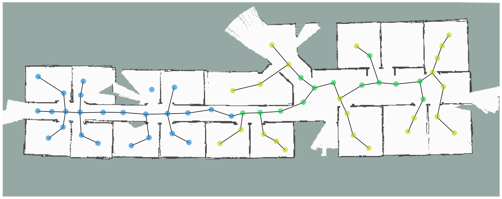
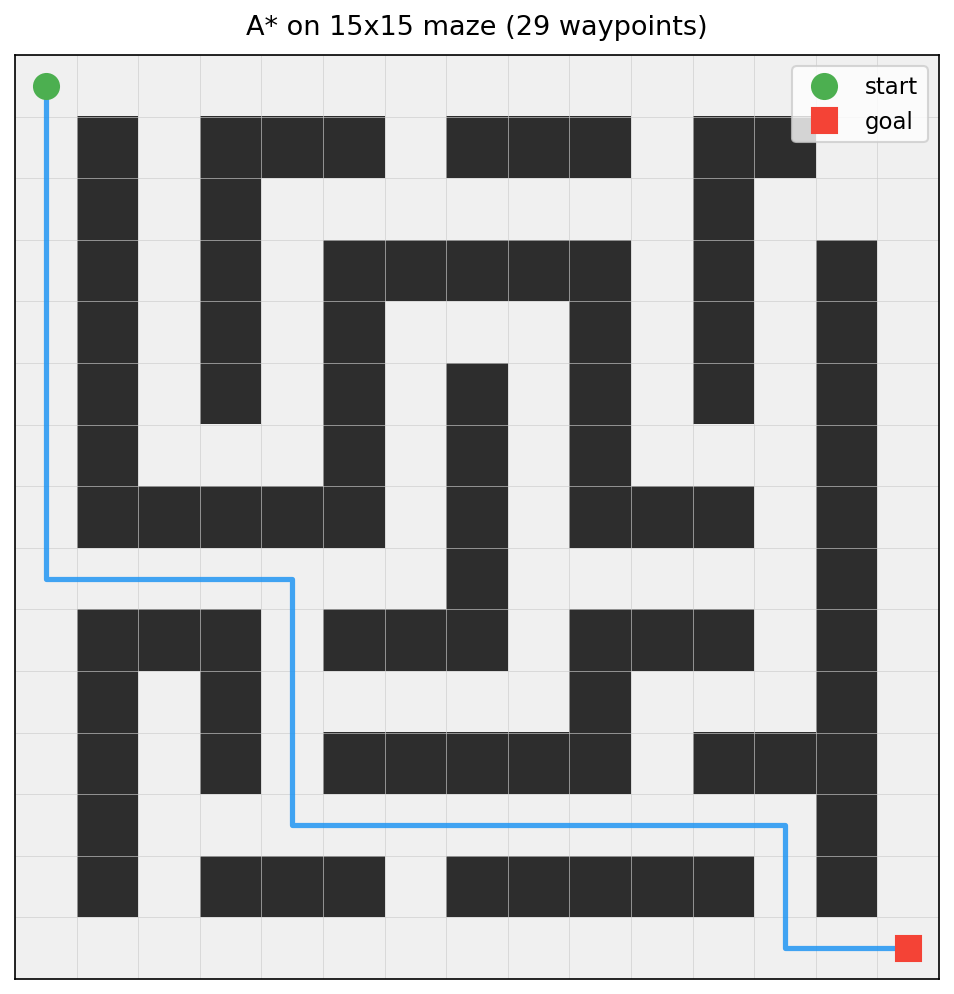
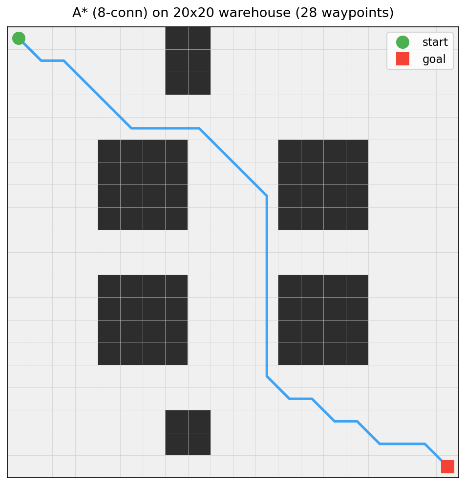

<p align="center">
  
</p>

# Path planning with A* and RRT on occupancy grids

A* finds a 29-waypoint route through the bundled 15 by 15 maze when it may only move along the four
compass directions, and a 28-waypoint route across the 20 by 20 warehouse when diagonal moves are
allowed, at a total cost of 31.556 against the 38.000 the four-direction version pays for the same
problem. Those four numbers come from two separate programs: the C++ planner in `src/`, and a
deliberately plain Python A* in `scripts/check_paths.py` written to disagree with it if either one is
wrong. They agree.

Written in C++17, with a Python script for drawing the results.

### Maze, four-connected



### Warehouse, eight-connected



## The two planners

**A*** searches the grid outward from the start, always expanding whichever reachable cell has the
lowest estimated total cost, and stops the moment it pops the goal. It returns the shortest path
there is, as long as the estimate never overshoots the true remaining distance.

The open set is a hand-written binary min-heap rather than `std::priority_queue`. The reason is
decrease-key: when A* finds a cheaper route to a cell already waiting in the queue, it needs to lower
that cell's priority in place. The standard container cannot do it, which leaves two options, either
pushing a duplicate entry and ignoring the stale one later, or rebuilding the heap. The heap here
keeps a map from grid index to heap position, so lowering a key costs one sift-up and the open set
never fills with stale duplicates. See `MinHeap::decrease` in `src/astar.cpp`.

Diagonal moves are allowed in eight-connected mode but may not cut a corner: a step from (x, y) to
(x+1, y+1) is rejected unless both (x+1, y) and (x, y+1) are free. Without that rule a path will slip
diagonally between two touching walls, which looks fine on a plot and is impossible for anything with
a physical width. The Python reference applies the same rule, which is why the two agree.

Heuristic is Euclidean by default, because it stays admissible whether diagonals are on or off.
Manhattan is available and is the tighter choice when movement is restricted to four directions.

**RRT** grows a tree from the start by repeatedly sampling a random point, finding the nearest node
already in the tree, and extending a short step toward it. It gives up optimality for speed and for
the ability to work in spaces where enumerating every cell is hopeless. One sample in twenty is placed
on the goal rather than at random, which pulls the tree toward the target instead of letting it
wander. Nodes hold floating-point positions and collision checks walk the line between two points with
a Bresenham traversal, so the tree is not snapped to cell centres.

Nearest-neighbour lookup is a linear scan over the tree. That is fine at these sizes and would want a
k-d tree well before the grid reached a thousand cells a side.

**Smoothing** repeatedly picks two non-adjacent waypoints at random and replaces everything between
them with a straight line whenever that line is clear. It exists for RRT output, which zigzags because
of the random sampling. Running it on an A* path does almost nothing, since that path is already
optimal.

## Grid format

Plain text. `.` is free, `#` is a wall, `D` is a third class of cell that the loader keeps separate
from ordinary walls. Planning treats `D` as blocked; the separate state exists so an obstacle can be
cleared and the route planned again without rewriting the map. Neither bundled scenario uses `D`, and
there is no replanning loop in the CLI, so that path is a hook rather than a demonstration.

## Build and run

```
mkdir build && cd build
cmake .. -DCMAKE_BUILD_TYPE=Release
make
```

Needs a C++17 compiler.

```
./planner --grid <file> --start x,y --goal x,y --algo astar|rrt [--smooth] [--eight]
```

Draw the result:

```
./planner --grid ../scenarios/maze.txt --start 0,0 --goal 14,14 --algo astar | \
    python3 ../scripts/visualize.py --grid ../scenarios/maze.txt
```

Tests live in `tests/` and are built by the same CMake file:

```
cd build && ctest --output-on-failure
```

The independent check, which needs no compiler:

```
python scripts/check_paths.py
```

## Limits

- Grids are two-dimensional and uniform. No terrain cost, no slopes, no cells that are expensive
  rather than impassable.
- A single agent. Nothing here reasons about two paths that would collide with each other.
- RRT has no rewiring step, so its paths are not asymptotically optimal the way RRT* would be.
- The timing of either planner is not measured in this repository. Both are standard algorithms whose
  complexity is well known, and a benchmark number without the machine it ran on says very little.

## References

1. Hart, P. E., Nilsson, N. J. & Raphael, B. (1968). A formal basis for the heuristic determination of
   minimum cost paths. *IEEE Transactions on Systems Science and Cybernetics*, 4(2), 100-107.
2. LaValle, S. M. (1998). Rapidly-exploring random trees: a new tool for path planning. *Technical
   Report 98-11*, Iowa State University.
3. Geraerts, R. & Overmars, M. H. (2007). Creating high-quality paths for motion planning.
   *International Journal of Robotics Research*, 26(8), 845-863.

## License

MIT
